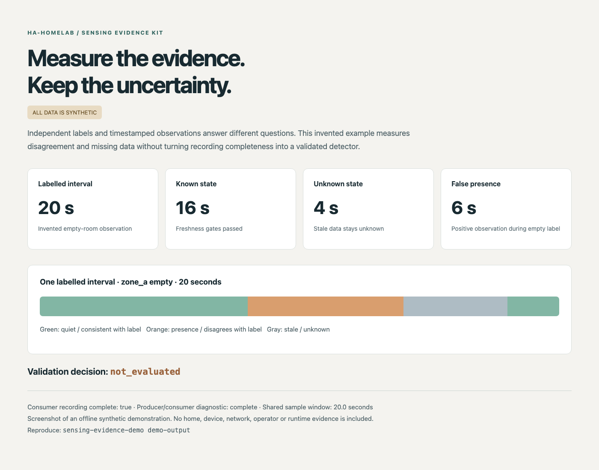

# Sensing Evidence Kit

[](docs/fuzzing.md)

[](https://www.bestpractices.dev/projects/15580)

**Characterization, not automatic validation.**

Capture selected Home Assistant observations, record independent operator labels and measure disagreements and unknown time. An optional offline joint report checks the integrity and time alignment of consumer and producer evidence. Every report keeps `validation_decision: not_evaluated`.

Select a tag from [Releases](https://github.com/ha-homelab/sensing-evidence-kit/releases): `-beta.N` identifies a beta, `-rc.N` a release candidate, and a tag without a prerelease suffix a stable software release. Verify the release's [signed asset inventory](docs/release-signatures.md) for that tag before installation. Stable software does not establish validated occupancy detection or sensing accuracy.



*All data in this screenshot is invented. It demonstrates reporting behavior, not a real home, hardware test or accuracy result.*

## Try the offline demonstration

Python 3.11 or newer is required. From a release source archive or checkout:

```sh
python3 -m venv .venv
. .venv/bin/activate
python3 -m pip install .
sensing-evidence-demo demo-output
```

Open `demo-output/demo.html`. The same folder contains synthetic consumer/producer evidence and JSON reports. The demonstration uses the production adapter, report and joint-analysis APIs. It does not read real host identifiers, connect to Home Assistant, contact MQTT or operate devices. Installation may download build dependencies; the installed demo/report tools need no runtime dependencies or network access.

The invented empty-room interval contains 16 seconds of known state, including 6 seconds of false presence, and 4 seconds of unknown state. Missing or stale evidence is not counted as a correct negative.

## Use your own evidence

The [tutorial](docs/tutorial.md) explains the full workflow: configure a read-only entity adapter, initialize a private session, record observations, add independent labels and create a report. Live capture is optional:

```sh
python3 -m pip install '.[record]'
```

Live capture reads Home Assistant through its WebSocket API. It never calls device services or changes entity states. You choose the tracked entities and store your session locally. Session metadata includes opaque host/boot identity, configuration fingerprints and selected observations; treat recordings as private.

## Useful for

- Comparing a sensor's observations against independent, explicitly timed labels.
- Distinguishing false presence, missed presence and unknown/stale periods.
- Checking that bindings and observation semantics remained consistent during a session.
- Checking same-host producer/consumer sample-window overlap without claiming exact event latency.
- Writing and testing another adapter against a shared reporting engine.

The built-in adapter characterizes ordinary binary entities as `presence`, `quiet` or `unknown`. It does not infer motion from a binary presence sensor. Hardware calibration, coverage certification, safety applications and automated promotion of a detector are outside this package's scope.

## Documentation

- [Tutorial and private recording](docs/tutorial.md)
- [Reproducibility, privacy and upgrades](docs/reproducibility.md)
- [Evidence contract and interpretation](docs/contracts.md)
- [Adapter API and integration](docs/adapters.md)
- [Troubleshooting](docs/troubleshooting.md)
- [Scope and limitations](docs/beta.md)
- [Security profiles](docs/security-profiles.md), [quality evidence](docs/quality.md), [governance](GOVERNANCE.md) and [roadmap](ROADMAP.md)
- [Security](SECURITY.md), [contributing](CONTRIBUTING.md), [changelog](CHANGELOG.md)

## Develop and package

```sh
python3 -m pip install '.[dev]'
./scripts/check.sh
python3 scripts/build_release.py
```

Checks block outgoing sockets and DNS and use invented fixtures. The release builder creates a source ZIP, sdist, wheel and SHA-256 checksums without publishing. Project-owned code is MIT licensed; see [dependency notices](THIRD_PARTY_NOTICES.md).
